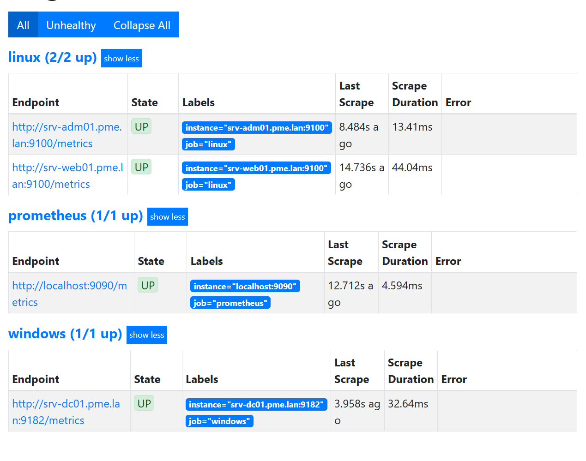
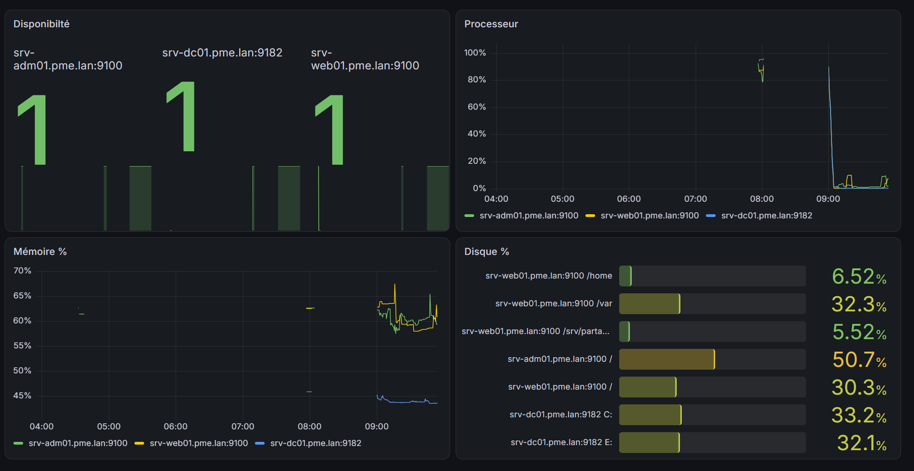
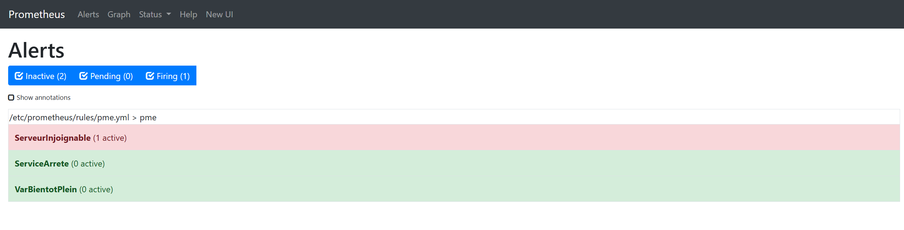

# Supervision du SI

| Composant | Serveur | Port |
| --- | --- | --- |
| node_exporter | SRV-WEB01, SRV-ADM01 | 9100 (ouvert à 10.10.0.30 seulement) |
| windows_exporter | SRV-DC01 | 9182 (ouvert à 10.10.0.30 seulement) |
| Prometheus | SRV-ADM01 | 9090 |
| Grafana | SRV-ADM01 | 3000 |

Configuration : `supervision/prometheus.yml`, règles : `supervision/pme.yml`, tableau de bord : `supervision/parc-pme.json` (Dashboards › Import).

## Règles d'alerte
- **ServeurInjoignable** : `up == 0` pendant 1 min (critique).
- **VarBientotPlein** : moins de 15 % libre sur /var pendant 10 min (avertissement).
- **ServiceArrete** : ssh, nginx ou smbd inactif pendant 1 min (critique).

## Test de l'alerte ServeurInjoignable
Condition provoquée : arrêt de node_exporter sur SRV-WEB01 depuis SRV-ADM01 :
`ansible web -b -m service -a "name=prometheus-node-exporter state=stopped"`

Prometheus ne lit plus la cible srv-web01:9100, `up` passe à 0 : l'alerte passe en Pending, puis en Firing au bout d'une minute (`for: 1m`). L'exporteur est ensuite relancé (`state=started`) et l'alerte se résout.

## Note : windows_exporter récent
Les métriques processeur s'appellent `windows_cpu_time_seconds_total` (et non `windows_cpu_time_total` comme dans la fiche) : requêtes du tableau de bord adaptées.

## Panne détectée grâce au tableau de bord (10/11)
`/srv/partage` absent du panneau Disques : RAID md0 non assemblé au démarrage (ligne ARRAY en double dans mdadm.conf). Voir ETAT.md.
